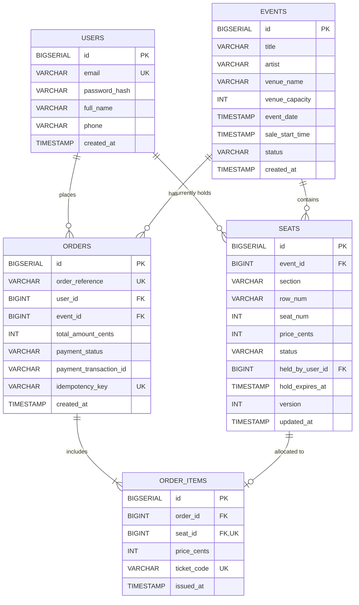

# TicketHub: Scalable Event Ticketing System Design Specification

A comprehensive technical architecture, capacity estimation, API specification, and concurrency control design for **TicketHub**—a high-scale web platform selling tickets for high-demand concerts and live events.

---

## 1. System Requirements

### 1.1 Functional Requirements
1. **Event Search & Discovery**: Users can browse, search, and filter upcoming events by artist, venue, genre, and date, retrieving paginated lists with venue details.
2. **Interactive Seating Chart**: Users can view real-time seating availability for any event, displaying section tiers, row numbers, individual seats, and pricing.
3. **Atomic Seat Holding (Reservation)**: Users can select one or more available seats (up to a maximum of 4 seats per customer) and place a temporary 10-minute hold while completing checkout.
4. **Secure Checkout & Payment**: Users can submit billing information to pay for their held seats. The system interfaces with an external payment gateway (e.g., Stripe) using idempotent transactions.
5. **Digital Ticket Issuance & Retrieval**: Upon verified payment, the system converts held seats into permanent tickets, assigns cryptographically unique QR/barcodes, and allows users to view their active and past tickets.
6. **Automated Hold Expiration**: If a user abandons their checkout or fails to pay within 10 minutes, held seats are automatically released back into the available pool without administrative intervention.

### 1.2 Non-Functional Requirements

#### Speed (Low Latency)
- **Read Latency**: Event listing and seat-map availability queries must return in under **$150\text{ ms}$** at the 99th percentile ($P99$), achieved via edge CDN caching and in-memory caches.
- **Write / Transactional Latency**: Seat hold requests and checkout operations must complete in under **$500\text{ ms}$** under peak load to prevent UI freezing and user drop-off.

#### Correctness (Data Integrity & Zero Double-Booking)
- **Absolute Non-Negotiable Invariant**: Under no circumstance may two different users purchase or hold the same physical seat for the same event (**zero double-booking**).
- **Strict ACID Transactions**: State transitions (`Available` $\rightarrow$ `Held` $\rightarrow$ `Sold`) must execute under strict serializable or row-level atomic guarantees.
- **Payment & Order Idempotency**: Network retries during checkout must never trigger duplicate credit card charges or create redundant order records.

#### Fairness & Abuse Prevention
- **Virtual Waiting Room (Queueing)**: During mega-concert flash sales, sudden spikes of hundreds of thousands of users are metered through a First-Come, First-Served (FIFO) virtual queue, guaranteeing orderly access.
- **Bot Mitigation & Rate Limiting**: Enforce IP and authenticated user rate limits (e.g., maximum 5 seat-hold attempts per minute) along with CAPTCHA verification on checkout to eliminate automated scalper bots.
- **Purchase Caps**: Strict business rule capping any single account at 4 tickets per event to ensure broad, equitable fan access.

#### High Availability & Fault Tolerance
- **$99.99\%$ Service Availability**: The system must withstand infrastructure failures without customer-visible downtime.
- **Graceful Load Shedding**: If incoming traffic exceeds peak provisioned capacity, the system must shed non-critical background workloads and throttle new entries via the waiting room rather than crashing the core relational database.

---

## 2. Traffic & Capacity Estimations

### 2.1 Given Facts
- **Registered Users**: $2,000,000$ ($2$ million total users).
- **Normal Day Traffic**:
  - Daily Active Users (DAU): $50,000$ visitors/day.
  - Page Views per User: $10$ pages viewed per visit.
  - Normal Daily Sales: $5,000$ tickets sold/day.
- **Popular Concert On-Sale ("Big Sale")**:
  - Competing Buyers: $200,000$ concurrent people attempting to purchase.
  - Available Inventory: $20,000$ seats.
  - Flash Window: The entire surge hits within the first **$10$ minutes** ($600\text{ seconds}$).

---

### 2.2 Normal Day Capacity Analysis

#### Read Traffic (Page Views)
$$\text{Total Daily Page Views} = 50,000\text{ DAU} \times 10\text{ pages/user} = 500,000\text{ page views/day}$$

- **Average Reads Per Second**:
  $$\text{RPS}_{\text{normal, avg}} = \frac{500,000\text{ requests}}{86,400\text{ seconds}} \approx 5.79\text{ requests/sec}$$

- **Peak Normal Traffic ($3\times$ Rush Hour Multiplier)**:
  $$\text{RPS}_{\text{normal, peak}} = 5.787 \times 3 \approx 17.36\text{ requests/sec}$$

#### Write Traffic (Ticket Purchases)
$$\text{Total Daily Ticket Sales} = 5,000\text{ tickets/day}$$

- **Average Purchases Per Second**:
  $$\text{WPS}_{\text{normal, avg}} = \frac{5,000\text{ tickets}}{86,400\text{ seconds}} \approx 0.058\text{ purchases/sec}$$

- **Peak Normal Writes ($3\times$ Rush Hour Multiplier)**:
  $$\text{WPS}_{\text{normal, peak}} = 0.05787 \times 3 \approx 0.174\text{ purchases/sec}$$

*Verdict on Normal Days*: Normal traffic is minimal. A single modest application server and a standard relational database instance can easily process $18\text{ RPS}$ reads and $0.2\text{ WPS}$ writes with less than $5\%$ CPU utilization.

---

### 2.3 Flash Sale ("Big Sale") Peak Capacity Analysis

When a top-tier stadium concert goes on sale, $200,000$ eager fans descend on the site simultaneously within a $10$-minute ($600\text{ s}$) window.

#### Active Concurrency & Read Request Volume
- **Total Competing Users**: $200,000$ users.
- **User Activity Behavior**: During a high-stakes sale, users don't view a passive 10 pages over a whole day. Each user frantically refreshes the seating chart, clicks through different sections, tests seat availability, and polls for updates. Assuming an average of **$25$ HTTP requests per user** (browsing event, loading seat map, polling seat status, attempting holds, checking out):
  $$\text{Total Sale Requests} = 200,000\text{ users} \times 25\text{ requests} = 5,000,000\text{ requests in } 10\text{ minutes}$$

- **Average Flash Sale Read Throughput**:
  $$\text{RPS}_{\text{sale, avg}} = \frac{5,000,000\text{ requests}}{600\text{ seconds}} \approx 8,333.33\text{ requests/sec}$$

- **Instantaneous Peak Surge (Launch Second $T=0$)**:
  Traffic does not distribute evenly across 10 minutes. A massive stampede occurs right at the top of the hour when the sale goes live. At a $3\times$ to $4\times$ instantaneous peak multiplier:
  $$\text{RPS}_{\text{sale, peak}} = 8,333.33 \times 3.5 \approx 29,166.67\text{ requests/sec}\quad (\approx 30,000\text{ RPS})$$

#### Write Traffic & Seat-Hold Contention
- **Seat Inventory**: $20,000$ total seats.
- **Ratio of Buyers to Seats**:
  $$\text{Competition Ratio} = \frac{200,000\text{ buyers}}{20,000\text{ seats}} = 10\text{ buyers for every } 1\text{ available seat}$$
- **Hold Attempts**:
  All $200,000$ users attempt to place a seat hold within the first $10$ minutes:
  $$\text{Average Hold Attempts/sec} = \frac{200,000\text{ hold attempts}}{600\text{ seconds}} \approx 333.33\text{ hold attempts/sec}$$
  During the opening 60 seconds, burst attempts will reach **$2,000\text{ to } 3,000\text{ hold attempts/second}$**.
- **Successful Order Completions**:
  Assuming all $20,000$ seats are successfully purchased within the 10 minutes (at an average of $2$ tickets per order $= 10,000$ total successful orders):
  $$\text{Completed Orders/sec} = \frac{10,000\text{ orders}}{600\text{ seconds}} \approx 16.67\text{ orders/sec}\quad (33.33\text{ seats sold/sec})$$

---

### 2.4 Traffic Comparison: Normal Day vs. Big Sale Peak

| Performance Dimension | Normal Day (Average) | Normal Day (Peak Hour) | Big Sale (10-Min Average) | Big Sale (Opening Instant Peak) | Surge Multiplier (Peak vs. Normal Avg) |
| :--- | :--- | :--- | :--- | :--- | :--- |
| **Active Concurrent Users** | $\approx 250$ | $\approx 1,000$ | $200,000$ | $200,000$ | **$800\times$** |
| **Read Requests (RPS)** | $5.79\text{ req/s}$ | $17.36\text{ req/s}$ | $8,333.33\text{ req/s}$ | **$29,167\text{ req/s}$** | **$5,037\times$** |
| **Seat Hold Attempts** | $0.1\text{ holds/s}$ | $0.3\text{ holds/s}$ | $333.33\text{ holds/s}$ | **$2,500\text{ holds/s}$** | **$25,000\times$** |
| **Orders / Purchases** | $0.058\text{ sales/s}$ | $0.174\text{ sales/s}$ | $16.67\text{ orders/s}$ | **$50.00\text{ orders/s}$** | **$862\times$** |
| **Database Target Pattern** | Distributed across hundreds of events | Distributed across active listings | **Extreme hot-spot contention on 1 single event and its 20,000 seat rows** | Single row-lock contention spike | **Concentrated Hot Spot** |

### 2.5 Key Capacity Insights & Architectural Implications
1. **The Read Surge ($5,000\times$)**: If $30,000\text{ RPS}$ hit a standard database directly to render the seating chart, the database connection pool would be exhausted in milliseconds, causing total collapse. **Solution**: Seating charts and event metadata must be aggressively cached in edge CDNs and in-memory Redis clusters.
2. **The Write Contention Stampede ($25,000\times$)**: 200,000 users competing for 20,000 seats means 180,000 users are guaranteed to fail. If all 200,000 users execute database transactions simultaneously, database row locking (`FOR UPDATE`) will create catastrophic lock queues and deadlocks. **Solution**: Implement a **Virtual Waiting Room** at the edge to admit users at a controlled rate, paired with **In-Memory Redis Distributed Locks** to reject duplicate seat grabs before they touch the database.

---

## 3. RESTful API Specification

The TicketHub API follows REST principles, exchanging JSON payloads over HTTPS with explicit status codes.

```
Base URL: https://api.tickethub.com/api/v1
Authentication: Bearer <JWT_TOKEN>
```

---

### Endpoint 1: Browse & Search Events
Retrieves a paginated list of upcoming events with optional filters.

- **Method**: `GET`
- **Path**: `/api/v1/events`
- **Query Parameters**:
  - `query` (string, optional): Search keyword (e.g., `"Taylor Swift"`).
  - `genre` (string, optional): Event category (`"Concert"`, `"Sports"`, `"Theater"`).
  - `city` (string, optional): Filter by city.
  - `page` (integer, default `1`): Page number.
  - `limit` (integer, default `20`, max `50`): Results per page.
- **Headers**: `Accept: application/json`
- **Success Response (`200 OK`)**:
  ```json
  {
    "status": "success",
    "pagination": {
      "currentPage": 1,
      "totalPages": 8,
      "totalEvents": 154,
      "limit": 20
    },
    "data": [
      {
        "id": "evt_908234",
        "title": "Cosmic Symphony World Tour",
        "artist": "Starlight Ensemble",
        "genre": "Concert",
        "venue": {
          "name": "Grand Metropolis Arena",
          "city": "Seattle",
          "state": "WA",
          "capacity": 20000
        },
        "eventDate": "2026-12-15T20:00:00Z",
        "saleStartTime": "2026-11-01T10:00:00Z",
        "status": "on_sale",
        "minPriceCents": 6500,
        "maxPriceCents": 35000
      }
    ]
  }
  ```
- **Error Responses**:
  - `400 Bad Request`: Invalid query parameters or pagination values.

---

### Endpoint 2: View Seating Chart & Real-Time Availability
Retrieves the seating chart for a specific event with section tiers and real-time seat availability status (`available`, `held`, `sold`).

- **Method**: `GET`
- **Path**: `/api/v1/events/{eventId}/seats`
- **Path Parameters**:
  - `eventId` (string, required): Unique event identifier.
- **Query Parameters**:
  - `section` (string, optional): Filter to a specific section (e.g., `"Section-101"`).
- **Headers**: `Accept: application/json`
- **Success Response (`200 OK`)**:
  ```json
  {
    "status": "success",
    "eventId": "evt_908234",
    "totalSeats": 20000,
    "availableSeats": 4210,
    "heldSeats": 1180,
    "soldSeats": 14610,
    "seats": [
      {
        "id": "seat_101_A_12",
        "section": "101",
        "row": "A",
        "seatNumber": 12,
        "tier": "VIP Floor",
        "priceCents": 25000,
        "status": "available"
      },
      {
        "id": "seat_101_A_13",
        "section": "101",
        "row": "A",
        "seatNumber": 13,
        "tier": "VIP Floor",
        "priceCents": 25000,
        "status": "held"
      },
      {
        "id": "seat_101_A_14",
        "section": "101",
        "row": "A",
        "seatNumber": 14,
        "tier": "VIP Floor",
        "priceCents": 25000,
        "status": "sold"
      }
    ]
  }
  ```
- **Error Responses**:
  - `404 Not Found`: Event ID does not exist.

---

### Endpoint 3: Hold Selected Seats (10-Minute Reservation)
Atomically places a temporary 10-minute hold on one or more selected seats for the authenticated user.

- **Method**: `POST`
- **Path**: `/api/v1/events/{eventId}/holds`
- **Headers**:
  - `Content-Type: application/json`
  - `Authorization: Bearer <JWT_TOKEN>`
- **Request Body**:
  ```json
  {
    "seatIds": [
      "seat_101_A_12",
      "seat_101_A_13"
    ]
  }
  ```
- **Validation Rules**:
  - Maximum of 4 seats per hold request.
  - All requested seats must be in `available` status (or expired hold).
- **Success Response (`201 Created`)**:
  ```json
  {
    "status": "success",
    "holdToken": "hld_tok_7f9a2c1b84e3",
    "eventId": "evt_908234",
    "heldSeats": [
      {
        "id": "seat_101_A_12",
        "section": "101",
        "row": "A",
        "seatNumber": 12,
        "priceCents": 25000
      },
      {
        "id": "seat_101_A_13",
        "section": "101",
        "row": "A",
        "seatNumber": 13,
        "priceCents": 25000
      }
    ],
    "totalPriceCents": 50000,
    "heldAt": "2026-11-01T10:02:14Z",
    "expiresAt": "2026-11-01T10:12:14Z",
    "ttlSeconds": 600
  }
  ```
- **Error Responses**:
  - `400 Bad Request`: Exceeds maximum limit of 4 seats per customer.
  - `401 Unauthorized`: Missing or invalid authentication token.
  - `409 Conflict`: One or more requested seats are already held or purchased by another user.
    ```json
    {
      "status": "error",
      "code": "SEATS_UNAVAILABLE",
      "message": "Seat seat_101_A_13 was just reserved by another user. Please select another seat.",
      "conflictedSeatIds": ["seat_101_A_13"]
    }
    ```
  - `429 Too Many Requests`: User exceeded rate limit of seat hold attempts.

---

### Endpoint 4: Pay & Complete Order (Checkout)
Submits payment details to purchase the held seats. Includes an `Idempotency-Key` header to safely allow network retries without double-charging.

- **Method**: `POST`
- **Path**: `/api/v1/orders/checkout`
- **Headers**:
  - `Content-Type: application/json`
  - `Authorization: Bearer <JWT_TOKEN>`
  - `Idempotency-Key: idemp_9a8b7c6d5e4f3a2b` (unique client UUID)
- **Request Body**:
  ```json
  {
    "holdToken": "hld_tok_7f9a2c1b84e3",
    "eventId": "evt_908234",
    "paymentMethodId": "pm_card_visa_tok9921",
    "billingDetails": {
      "name": "Jane Doe",
      "postalCode": "98101"
    }
  }
  ```
- **Success Response (`201 Created`)**:
  ```json
  {
    "status": "success",
    "orderId": "ord_88320491",
    "orderReference": "TH-2026-908234-8832",
    "totalAmountCents": 50000,
    "currency": "USD",
    "paymentStatus": "completed",
    "transactionId": "txn_strp_481029410",
    "createdAt": "2026-11-01T10:05:42Z",
    "ticketsCount": 2,
    "ticketsUrl": "/api/v1/users/usr_482910/tickets"
  }
  ```
- **Error Responses**:
  - `400 Bad Request`: Missing mandatory fields or malformed payment token.
  - `402 Payment Required`: Payment declined by card issuer (e.g., insufficient funds).
  - `409 Conflict`: Hold has expired; seats have already been returned to available pool.
  - `422 Unprocessable Entity`: Seat hold token does not match authenticated user.

---

### Endpoint 5: Retrieve Purchased Tickets
Retrieves the digital tickets and QR barcodes for the authenticated user, either for a specific order or across all purchases.

- **Method**: `GET`
- **Path**: `/api/v1/users/{userId}/tickets`
- **Path Parameters**:
  - `userId` (string, required): Authenticated user ID (must match JWT subject).
- **Query Parameters**:
  - `status` (string, optional): `"active"` or `"past"`.
  - `eventId` (string, optional): Filter by event.
- **Headers**:
  - `Authorization: Bearer <JWT_TOKEN>`
  - `Accept: application/json`
- **Success Response (`200 OK`)**:
  ```json
  {
    "status": "success",
    "userId": "usr_482910",
    "tickets": [
      {
        "ticketId": "tkt_10928301",
        "orderId": "ord_88320491",
        "event": {
          "id": "evt_908234",
          "title": "Cosmic Symphony World Tour",
          "venue": "Grand Metropolis Arena",
          "eventDate": "2026-12-15T20:00:00Z"
        },
        "seat": {
          "section": "101",
          "row": "A",
          "seatNumber": 12,
          "tier": "VIP Floor"
        },
        "pricePaidCents": 25000,
        "barcodeCode": "TH-908234-101-A-12-X89F2",
        "qrCodePayload": "https://tickethub.com/verify/tkt_10928301?sig=99f8e4a7",
        "issuedAt": "2026-11-01T10:05:43Z"
      },
      {
        "ticketId": "tkt_10928302",
        "orderId": "ord_88320491",
        "event": {
          "id": "evt_908234",
          "title": "Cosmic Symphony World Tour",
          "venue": "Grand Metropolis Arena",
          "eventDate": "2026-12-15T20:00:00Z"
        },
        "seat": {
          "section": "101",
          "row": "A",
          "seatNumber": 13,
          "tier": "VIP Floor"
        },
        "pricePaidCents": 25000,
        "barcodeCode": "TH-908234-101-A-13-Y12B4",
        "qrCodePayload": "https://tickethub.com/verify/tkt_10928302?sig=77a2c9d1",
        "issuedAt": "2026-11-01T10:05:43Z"
      }
    ]
  }
  ```
- **Error Responses**:
  - `401 Unauthorized`: Token missing or invalid.
  - `403 Forbidden`: Authenticated user does not have permission to view another user's tickets.

---

## 4. Relational Data Model & Database Schema

TicketHub employs a relational database (PostgreSQL) to enforce strict referential integrity, ACID transactional boundaries, and composite unique constraints.

### 4.1 Entity Relationship Diagram (ERD)



---

### 4.2 Database DDL Specifications

```sql
-- 1. USERS TABLE
CREATE TABLE users (
    id BIGSERIAL PRIMARY KEY,
    email VARCHAR(255) NOT NULL UNIQUE,
    password_hash VARCHAR(255) NOT NULL,
    full_name VARCHAR(150) NOT NULL,
    phone VARCHAR(30),
    created_at TIMESTAMP WITH TIME ZONE DEFAULT CURRENT_TIMESTAMP,
    updated_at TIMESTAMP WITH TIME ZONE DEFAULT CURRENT_TIMESTAMP
);

-- 2. EVENTS TABLE
CREATE TABLE events (
    id BIGSERIAL PRIMARY KEY,
    title VARCHAR(255) NOT NULL,
    artist VARCHAR(255) NOT NULL,
    venue_name VARCHAR(255) NOT NULL,
    venue_capacity INT NOT NULL CHECK (venue_capacity > 0),
    event_date TIMESTAMP WITH TIME ZONE NOT NULL,
    sale_start_time TIMESTAMP WITH TIME ZONE NOT NULL,
    status VARCHAR(50) NOT NULL DEFAULT 'upcoming' 
        CHECK (status IN ('upcoming', 'on_sale', 'sold_out', 'completed', 'cancelled')),
    created_at TIMESTAMP WITH TIME ZONE DEFAULT CURRENT_TIMESTAMP
);

-- 3. SEATS TABLE
CREATE TABLE seats (
    id BIGSERIAL PRIMARY KEY,
    event_id BIGINT NOT NULL REFERENCES events(id) ON DELETE CASCADE,
    section VARCHAR(50) NOT NULL,
    row_num VARCHAR(20) NOT NULL,
    seat_num INT NOT NULL,
    price_cents INT NOT NULL CHECK (price_cents >= 0),
    status VARCHAR(20) NOT NULL DEFAULT 'available'
        CHECK (status IN ('available', 'held', 'sold')),
    held_by_user_id BIGINT REFERENCES users(id) ON DELETE SET NULL,
    hold_expires_at TIMESTAMP WITH TIME ZONE,
    version INT NOT NULL DEFAULT 1,
    updated_at TIMESTAMP WITH TIME ZONE DEFAULT CURRENT_TIMESTAMP,
    -- Prevent duplicate physical seat configurations within the same event
    CONSTRAINT uq_event_seat UNIQUE (event_id, section, row_num, seat_num)
);

-- 4. ORDERS TABLE
CREATE TABLE orders (
    id BIGSERIAL PRIMARY KEY,
    order_reference VARCHAR(64) NOT NULL UNIQUE,
    user_id BIGINT NOT NULL REFERENCES users(id) ON DELETE RESTRICT,
    event_id BIGINT NOT NULL REFERENCES events(id) ON DELETE RESTRICT,
    total_amount_cents INT NOT NULL CHECK (total_amount_cents >= 0),
    payment_status VARCHAR(30) NOT NULL DEFAULT 'pending'
        CHECK (payment_status IN ('pending', 'completed', 'failed', 'refunded')),
    payment_transaction_id VARCHAR(128),
    idempotency_key VARCHAR(128) NOT NULL UNIQUE,
    created_at TIMESTAMP WITH TIME ZONE DEFAULT CURRENT_TIMESTAMP,
    updated_at TIMESTAMP WITH TIME ZONE DEFAULT CURRENT_TIMESTAMP
);

-- 5. ORDER_ITEMS (TICKETS) JUNCTION TABLE
CREATE TABLE order_items (
    id BIGSERIAL PRIMARY KEY,
    order_id BIGINT NOT NULL REFERENCES orders(id) ON DELETE CASCADE,
    seat_id BIGINT NOT NULL REFERENCES seats(id) ON DELETE RESTRICT,
    price_cents INT NOT NULL CHECK (price_cents >= 0),
    ticket_code VARCHAR(128) NOT NULL UNIQUE,
    issued_at TIMESTAMP WITH TIME ZONE DEFAULT CURRENT_TIMESTAMP,
    -- CRITICAL INVARIANT: A seat cannot be linked to more than one order item!
    CONSTRAINT uq_seat_single_ticket UNIQUE (seat_id)
);
```

---

### 4.3 High-Performance Indexing Strategy & Big-O Rationale

```sql
-- Index 1: Fast seat availability lookups per event
CREATE INDEX idx_seats_event_status ON seats(event_id, status);

-- Index 2: Fast sweeper query to clean up expired holds
CREATE INDEX idx_seats_expired_holds ON seats(status, hold_expires_at) 
WHERE status = 'held';

-- Index 3: User order lookup history
CREATE INDEX idx_orders_user_id ON orders(user_id, created_at DESC);

-- Index 4: Event lookup by date and sale status
CREATE INDEX idx_events_status_date ON events(status, sale_start_time);
```

#### Index Justifications:
1. `idx_seats_event_status`: When thousands of clients fetch seat maps (`GET /events/{id}/seats`), filtering by `event_id` and grouping by `status` drops from an $O(N)$ full table scan over millions of seat rows to an $O(\log N + K)$ B-Tree index scan.
2. `idx_seats_expired_holds`: A partial index specifically targeting held seats whose timestamp has passed. The background cleanup worker evaluates this index in $O(M)$ time where $M$ is only the number of currently held seats, completely ignoring millions of available and sold rows.
3. `uq_seat_single_ticket`: Beyond serving as a foreign-key lookup, this database-level constraint physically prevents the database engine from ever inserting two tickets referencing the same seat ID.

---

## 5. Concurrency Control: How Double-Booking Is Strictly Prevented

The single most challenging engineering requirement in ticketing is eliminating **race conditions** when $200,000$ fans attempt to click the same $20,000$ seats at the exact same instant.

### 5.1 The Double-Booking Race Condition Problem
If two users, Alice and Bob, simultaneously click Seat 101-A-12:
1. Alice's server thread reads `status = 'available'`.
2. Bob's server thread reads `status = 'available'`.
3. Alice's thread writes `status = 'held'`.
4. Bob's thread writes `status = 'held'`.
5. Both Alice and Bob enter checkout, pay their money, and two tickets are printed for the same seat.

This catastrophic bug is prevented in TicketHub using a **defense-in-depth, 4-tier concurrency control strategy**.

---

### 5.2 Tier 1: Two-Phase Reservation State Machine
Seats never transition directly from `Available` to `Sold`. Instead, they move through a strictly enforced state machine:

```
[ Available ] 
     | 
     | (User holds seat: acquires 10-minute hold token)
     v
  [ Held ] --------(10-minute timer expires OR checkout cancelled)-------> [ Available ]
     |
     | (Payment verified via Stripe within 10 minutes)
     v
  [ Sold ]  (Permanent terminal state: Ticket issued)
```

---

### 5.3 Tier 2: Database Concurrency Control & Row Locking

#### Mechanism A: Atomic Conditional Update (Optimistic Concurrency Control)
Our primary holding query uses an **Atomic Conditional Update with Version Increment**. In SQL:

```sql
UPDATE seats
SET status = 'held',
    held_by_user_id = :userId,
    hold_expires_at = CURRENT_TIMESTAMP + INTERVAL '10 minutes',
    version = version + 1,
    updated_at = CURRENT_TIMESTAMP
WHERE id = :seatId
  AND (
      status = 'available'
      OR (status = 'held' AND hold_expires_at < CURRENT_TIMESTAMP)
  );
```

**Why this guarantees zero double-booking:**
- In relational databases (PostgreSQL/MySQL), `UPDATE` statements acquire an exclusive row-level write lock on the target row for the duration of the statement execution.
- If Alice and Bob submit hold requests at the exact same millisecond:
  - Alice's statement reaches the row first. The condition `status = 'available'` evaluates to `TRUE`. The row is updated, its status becomes `'held'`, version becomes `version + 1`, and the database reports **`Rows Affected: 1`**.
  - Bob's statement executes immediately next. The database evaluates the condition `status = 'available' OR (status = 'held' AND hold_expires_at < CURRENT_TIMESTAMP)`. Because Alice just updated the row to `'held'` with an expiration 10 minutes in the future, the condition evaluates to **`FALSE`**.
  - The database reports **`Rows Affected: 0`**.
  - The application backend inspects `Rows Affected`. If it is `0`, the server immediately aborts the transaction, releases any locks, and returns an HTTP `409 Conflict` to Bob with `"Seat already reserved"`.

#### Mechanism B: Pessimistic Row Locking (`SELECT FOR UPDATE`) for Multi-Seat Holds
When a user holds multiple seats together (e.g., 2 adjacent seats for a couple), all requested seats must be reserved atomically—or none at all:

```sql
BEGIN TRANSACTION;

-- 1. Lock only the requested seat rows in deterministic ID order to avoid deadlocks
SELECT id, status, hold_expires_at 
FROM seats 
WHERE id IN (:seatId1, :seatId2) AND event_id = :eventId
ORDER BY id ASC
FOR UPDATE;

-- 2. Verify in application logic that ALL requested seats are available (or expired)
-- If ANY seat is already held or sold:
--     ROLLBACK;
--     RETURN 409 Conflict;

-- 3. If ALL seats are valid, update them together:
UPDATE seats
SET status = 'held',
    held_by_user_id = :userId,
    hold_expires_at = CURRENT_TIMESTAMP + INTERVAL '10 minutes',
    version = version + 1
WHERE id IN (:seatId1, :seatId2);

COMMIT;
```
- By ordering seat IDs (`ORDER BY id ASC`), concurrent transactions locking seats (e.g., Alice reserving Seat 1 & 2 while Bob tries Seat 2 & 1) acquire locks in the exact same sequence, eliminating database deadlocks.

---

### 5.4 Tier 3: In-Memory Redis Distributed Locks (Fast Shock Absorber)
Under a $3,000\text{ hold attempts/sec}$ flash-sale spike, sending all failed requests directly to PostgreSQL would overwhelm database connection pools. 

Before hitting PostgreSQL, the API server executes an atomic **Redis Lua Script**:
```lua
-- KEYS[1] = "seat_lock:evt_908234:seat_101_A_12"
-- ARGV[1] = userId, ARGV[2] = ttl (600 seconds)
if redis.call("EXISTS", KEYS[1]) == 0 then
    redis.call("SET", KEYS[1], ARGV[1], "EX", ARGV[2])
    return 1 -- Lock acquired successfully
else
    return 0 -- Seat already held by someone else
end
```
- Over $90\%$ of competing hold requests are intercepted and rejected in Redis in $<2\text{ ms}$, shielding the primary PostgreSQL database from lock contention.

---

### 5.5 Tier 4: Database Unique Constraints as Ultimate Safety Net
Even if an application code error, caching bug, or distributed system partition were to occur, the database schema provides an inviolable mathematical guarantee:
```sql
CONSTRAINT uq_seat_single_ticket UNIQUE (seat_id)
```
When an order completes, the backend inserts a row into `order_items`. Because `seat_id` has a `UNIQUE` constraint, the database engine will throw a hard constraint violation (`PostgreSQL 23505 unique_violation`) if any attempt is ever made to issue a second ticket for the same seat.

---

## 6. System Architecture & Surviving the Big Sale

### 6.1 Complete Architecture Diagram

```mermaid
flowchart TD
    subgraph Clients["200,000 Competing Fan Clients (Mobile & Web)"]
        C1[Client 1]
        C2[Client 2]
        C3[Client 200,000]
    end

    subgraph Edge["Edge Layer (Cloudflare CDN & Virtual Waiting Room)"]
        DNS[Global DNS / Route 53]
        CDN[Edge CDN Cache<br/>Static Assets & Event Metadata]
        VWR[Virtual Waiting Room / FIFO Queue<br/>Meters traffic to max 500 users/sec]
    end

    subgraph Ingress["Ingress & Routing Layer"]
        ALB[Application Load Balancer (ALB)<br/>SSL Termination, Rate Limiting & Health Checks]
    end

    subgraph AppCluster["Stateless Application Cluster (Auto-scaling)"]
        API1[API Instance 1]
        API2[API Instance 2]
        API3[API Instance N]
    end

    subgraph Caching["Distributed Cache & Lock Layer"]
        RedisCluster[(Redis Cluster - In-Memory)<br/>Seat Bitmaps, Distributed Locks, Session Tokens]
    end

    subgraph Storage["Database Layer"]
        PrimaryDB[(Primary PostgreSQL DB - Writes)<br/>ACID Transactions, Row Locks, Unique Constraints]
        ReadRep1[(Read Replica 1 - Reads)]
        ReadRep2[(Read Replica 2 - Reads)]
    end

    subgraph Async["Asynchronous Worker Pipeline"]
        Queue[Message Broker / RabbitMQ<br/>Order Processing, PDF Tickets, Hold Sweeper]
        Worker1[Ticket Generation Worker]
        Worker2[Hold Expiration Sweeper Worker]
        Worker3[Email & Notification Worker]
    end

    subgraph External["External Services"]
        Stripe[Stripe Payment Gateway]
        SendGrid[SendGrid Email Delivery]
    end

    %% Client flows
    Clients --> DNS --> Edge
    CDN -- "Cache Hit (90% reads)" --> Clients
    Edge --> VWR
    VWR -- "Controlled Ingress" --> ALB
    ALB --> AppCluster

    %% Application flows
    API1 & API2 & API3 <--> RedisCluster
    API1 & API2 & API3 -- "Read Seat Charts" --> ReadRep1 & ReadRep2
    API1 & API2 & API3 -- "Write Holds & Orders (ACID)" --> PrimaryDB
    PrimaryDB -. "Asynchronous Replication" .-> ReadRep1 & ReadRep2

    %% External & Async flows
    API1 & API2 & API3 <--> Stripe
    API1 & API2 & API3 -- "Publish Order Event" --> Queue
    Queue --> Worker1 & Worker2 & Worker3
    Worker1 --> PrimaryDB
    Worker2 --> PrimaryDB & RedisCluster
    Worker3 --> SendGrid
```

---

### 6.2 Component Explanations & Big Sale Defense Mechanics

#### 1. Edge Layer: Cloudflare CDN & Virtual Waiting Room
- **Edge CDN**: Caches static assets (HTML/CSS/JS, seat-map SVG floor plans, artist bios, and event details). Absorbs over $90\%$ of read traffic during the initial spike without touching application servers.
- **Virtual Waiting Room (Queue-IT / Cloudflare Waiting Room)**: The critical component that guarantees survival during the $200,000$-user surge. Instead of allowing $200,000$ users to hit backend APIs simultaneously, the edge gatekeeper assigns each arriving user an encrypted, cryptographically signed queue cookie (FIFO queue). It meters ingress to **$500\text{ users per second}$**, exactly matching backend transactional capacity. Users see an estimated wait time and live queue position without refreshing.

#### 2. Application Load Balancer (ALB)
- Distributes decrypted HTTPS traffic evenly across the auto-scaling web application cluster using round-robin with least-outstanding-requests routing.
- Automatically removes unhealthy instances via health-check endpoints and enforces layer-7 rate limits (e.g., maximum 60 requests/min per IP) to neutralize automated scrapers.

#### 3. Stateless Application Cluster (API Web Servers)
- Built on a lightweight, asynchronous runtime (Node.js or Go). Because application servers store zero session state in local memory, they scale horizontally from $10$ instances during normal hours to **$80\text{ instances}$** automatically via Kubernetes Horizontal Pod Autoscalers (HPA) triggered by CPU utilization and request queue depth.
- Validates hold tokens, calculates prices, and coordinates transactions between Redis, PostgreSQL, and Stripe.

#### 4. Distributed In-Memory Cache (Redis Cluster)
- **Real-Time Seat Availability Bitmaps**: Maintains an in-memory bit array representing the state of all 20,000 seats. Reading seat map availability executes in sub-millisecond time (`O(1)` memory lookups) instead of querying SQL tables.
- **Distributed Hold Locks**: Uses short-lived Redis keys with automated TTLs (`SET seat:{id}:lock {userId} NX EX 600`) to reject duplicate seat hold attempts before they reach the database.

#### 5. Relational Database Cluster (PostgreSQL Primary + Read Replicas)
- **Primary Database Instance**: Dedicated exclusively to transactional writes (seat holds, payment confirmations, order generation). Isolated from read traffic, ensuring its full I/O capacity is dedicated to ACID serializable transactions.
- **Read Replicas**: Multiple read-only replicas handle browsing, user purchase history, and event searches. Asynchronous replication keeps replicas synchronized with the Primary.

#### 6. Asynchronous Message Broker & Worker Fleet
- **Message Broker (RabbitMQ / SQS)**: Decouples time-consuming post-payment tasks from the critical checkout path. Once payment succeeds, the API server publishes an `order.created` event and immediately returns `201 Created` to the user.
- **Ticket Generation Worker**: Consumes the event, generates secure cryptographic QR code payloads, and creates PDF ticket downloads.
- **Hold Expiration Sweeper Worker**: A lightweight scheduled cron/worker that runs every 10 seconds, identifying abandoned holds (`hold_expires_at < NOW()`) and atomically returning seats to `'available'` status while evicting stale Redis lock keys.

#### 7. External Payment Gateway (Stripe)
- Payment card information is tokenized client-side directly via Stripe Elements, ensuring PCI-DSS compliance. The backend charges the token with an idempotency key (`Idempotency-Key: {order_reference}`), ensuring that even if a network timeout occurs, retrying the charge will never bill the fan twice.

---

## 7. Architectural Trade-Offs

### Trade-Off 1: Optimistic Concurrency Control (OCC) vs. Pessimistic Row Locking (`FOR UPDATE`)

| Dimension | Optimistic Concurrency Control (Atomic Update + Version) | Pessimistic Locking (`SELECT FOR UPDATE`) |
| :--- | :--- | :--- |
| **Mechanics** | Executes `UPDATE ... WHERE id = :id AND status = 'available'`. Fails immediately if row was modified. | Holds open a database transaction and acquires exclusive lock on row before reading or writing. |
| **Throughput Under Normal Load** | **Extremely High**: Zero lock overhead; readers and writers never block each other. | **Moderate**: Locks incur database lock-manager overhead. |
| **Performance Under Heavy Contention** | **High Failure Rate / High CPU on Retries**: In high contention (10 people clicking 1 seat), 9 fail immediately without waiting. | **Severe Lock Contention & Bottlenecks**: 10 transactions queue up sequentially, holding database connection threads open and risking deadlocks. |
| **Deadlock Risk** | **Zero**: Single statement execution never deadlocks. | **High**: Locking multiple seats across concurrent transactions causes deadlocks unless ordered strictly. |
| **TicketHub Decision & Verdict** | **Selected Hybrid Approach**: We use **Optimistic Atomic Updates** combined with **Redis pre-locking** for individual seat holds. This prevents long database lock queues during the 200,000-user sale. For multi-seat holds within a single basket, we use **Pessimistic Locking with strictly ordered IDs** within a sub-second transaction to guarantee all-or-nothing seat reservations. |

---

### Trade-Off 2: Virtual Waiting Room (Edge Queueing) vs. Raw Auto-Scaling (Elastic Oversubscription)

| Dimension | Virtual Waiting Room (Our Architecture) | Raw Auto-Scaling (Elastic Oversubscription) |
| :--- | :--- | :--- |
| **User Experience (Perceived Fairness)** | **Transparent & Fair**: Users receive an exact queue position (e.g., #"1,420 in line") and estimated wait time. Eliminates chaotic page-refreshing battles. | **Frustrating & Random**: Users experience HTTP 504 Gateway Timeouts, spinning loaders, and random error pages as servers struggle to cope. |
| **Infrastructure Cost** | **Low to Moderate**: Backend is provisioned to comfortably handle $500\text{ writes/sec}$ rather than over-provisioned for a 10-minute $30,000\text{ RPS}$ spike that goes unused the rest of the year. | **Extremely Expensive**: Requires provisioning hundreds of high-memory database instances and web clusters that take 5–10 minutes to spin up (often finishing after the sale is already over). |
| **Database Protection** | **Total Protection**: The database never receives more queries than its connection pool and IOPS limits can sustain. | **Catastrophic Failure Risk**: A surge of 200,000 simultaneous connections exhausts database connection pools, crashing the entire database cluster. |
| **TicketHub Decision & Verdict** | **Selected Virtual Waiting Room**: When 200,000 people compete for 20,000 seats, 90% of users will leave empty-handed regardless of server size. Controlled edge queueing guarantees system stability, zero downtime, and provable first-come, first-served fairness. |

---

### Trade-Off 3: In-Memory Redis Seat Holding vs. Pure Relational Database Holding

| Dimension | Redis In-Memory Hold Layer (Our Architecture) | Pure Database Holding (Relational Only) |
| :--- | :--- | :--- |
| **Throughput & Speed** | **Sub-millisecond ($>50,000\text{ ops/sec}$)**: Fast memory operations absorb the initial 200,000-user click stampede effortlessly. | **Limited by Disk I/O ($1,000\text{--}3,000\text{ writes/sec}$)**: High disk I/O and WAL logging create latency bottlenecks under heavy load. |
| **Architectural Complexity** | **Higher**: Requires dual-state synchronization between Redis and PostgreSQL; must handle cache-invalidation edge cases. | **Simpler**: Single source of truth in PostgreSQL with standard SQL queries. |
| **Data Durability & Recovery** | **Slight Risk of Cache Drift**: If Redis node fails, lock status must be rehydrated from PostgreSQL database. | **Absolute ACID Durability**: Every write is immediately written to write-ahead logs (WAL) on disk. |
| **TicketHub Decision & Verdict** | **Selected Redis In-Memory Layer**: Redis acts as an upstream protective shield. Only requests that successfully acquire the in-memory hold lock are permitted to execute the PostgreSQL update. This dual-layer design protects the relational database from being crushed during flash sales while retaining PostgreSQL as the immutable, permanent source of truth for completed orders. |

---

### Trade-Off 4: User-Selected Interactive Seating Chart vs. Best-Available General Admission Auto-Assignment

| Dimension | User-Selected Interactive Seating (Our Choice) | Best-Available Auto-Assignment |
| :--- | :--- | :--- |
| **User Satisfaction** | **High**: Fans love picking their exact section, row, and aisle seat next to friends. | **Lower**: Fans have no control over their specific seats; the algorithm assigns them whatever is next in line. |
| **System Contention** | **High**: Multiple users can simultaneously click on the exact same popular seat (e.g., front-row center), triggering high row contention. | **Extremely Low**: The server sequentially dispenses seats from an internal queue, completely eliminating row contention. |
| **Network & Rendering Overhead** | **Higher**: Must transmit SVG seat coordinates and status arrays for 20,000 seats to client browsers. | **Minimal**: Client only requests "2 tickets in Tier 1", transmitting tiny JSON payloads. |
| **TicketHub Decision & Verdict** | **Selected User-Selected Seating with Fallback**: Fans demand interactive seat selection for high-value concert experiences. To mitigate the contention trade-off, we pair interactive maps with real-time WebSocket seat status broadcasts and Redis distributed locks. If a section reaches $>95\%$ capacity, the UI seamlessly switches to "Best Available" auto-assignment to rapidly clear remaining inventory without conflicts. |

---

## 8. Summary & Framework Compliance Checklist

| Framework Section | Implementation Details in This Document | Status |
| :--- | :--- | :--- |
| **1. Requirements** | Functional (Search, Seat Map, 10-Min Hold, Payment, Tickets, Expiry) and Non-Functional (Speed $<150\text{ms}$ reads / $<500\text{ms}$ writes, Correctness/Zero Double-Booking, Fairness/Waiting Room, Availability $99.99\%$). | Complete |
| **2. Traffic Estimates** | Rigorous mathematical breakdown comparing Normal Day ($5.79\text{ RPS}$ reads, $0.058\text{ WPS}$ writes) vs. Popular Concert Flash Sale ($8,333\text{--}30,000\text{ RPS}$ reads, $333\text{--}2,500\text{ holds/s}$), with ratio analysis ($10:1$ buyer-to-seat competition). | Complete |
| **3. API Design** | 5 comprehensive RESTful endpoints (`GET /events`, `GET /events/{id}/seats`, `POST /events/{id}/holds`, `POST /orders/checkout`, `GET /users/{id}/tickets`) with HTTP methods, path params, request/response JSON schemas, and error codes. | Complete |
| **4. Data Model** | 5 normalized relational tables (`users`, `events`, `seats`, `orders`, `order_items`), full SQL DDL, ER diagram, foreign keys, cascade rules, and B-tree indexes with big-O analysis. | Complete |
| **5. Concurrency Control** | In-depth explanation of race condition prevention using 2-phase state machines, Optimistic Atomic Updates (`WHERE status = 'available'`), Pessimistic Locks (`FOR UPDATE`), Redis distributed locks, and database `UNIQUE(seat_id)` constraints. | Complete |
| **6. Architecture Diagram** | Mermaid system diagram with detailed component-by-component operational breakdown explaining how Cloudflare Waiting Room, ALB, Redis, and Read Replicas survive the 200,000-user rush. | Complete |
| **7. Trade-Offs** | 4 detailed comparative trade-off tables (OCC vs. Pessimistic Locking, Waiting Room vs. Auto-Scaling, Redis Cache vs. Pure DB, User-Selected vs. Best-Available). | Complete |
